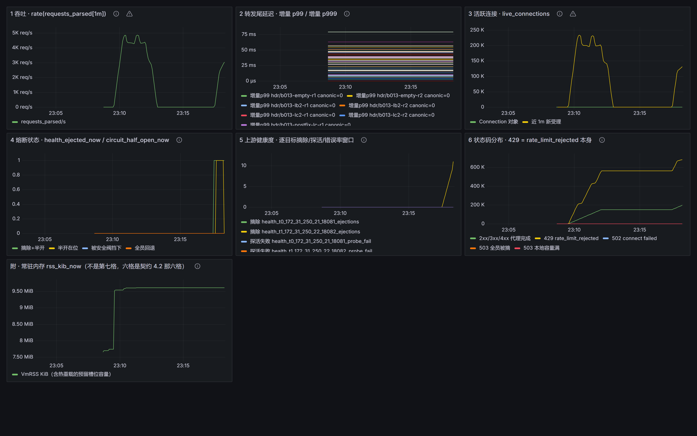
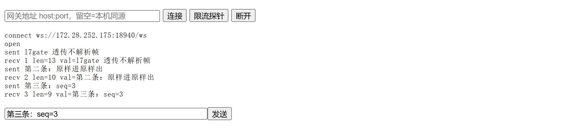

# l7gate

**一个单机部署的 C++20 L7 流量治理网关。** 网络核自研（epoll ET + 多线程 Reactor，零第三方库），解析 HTTP/1.1，按配置好的 filter 链做路由、负载均衡、健康检查与摘除、限流、熔断、超时与重试。

它不是"又一个高性能 Web 服务器"，也不是功能清单。对外形态是一个能顶替 Nginx 位置的网关，**要交付的东西是"网络层怎么写的"，以及整个过程的性能与故障边界被量出来的那三个数字——包括没达标的**。

[](docs/adr/ADR-04-no-third-party-network-lib.md)
[](docs/ROADMAP.md)
[](docs/FAULT-INJECTION.md)
[](docs/BENCHMARK.md)
[](docs/SLO.md)
[](LICENSE)

---

## 三个数字

项目的全部价值锚点。目标值与五条测量条件写死在 [docs/SLO.md](docs/SLO.md)，**任何情况下不许为了迁就实测而改目标**；未达标照记并归因。

| # | 指标 | 目标 | HEAD 终稿实测 | 判定 |
|---|---|---|---|---|
| **1** | 转发增量 p99 · 1 KiB 体 / 1000 并发 / 60 s 稳态 | ≤ 1.0 ms | `workers=16` 全带 **−0.740 ~ 4.480 ms**（最好一发 3.140） | ❌ **未达标** |
| **1b** | 转发增量 p999 · 同一档 | ≤ 5.0 ms | 观察者自己贴满单核，仪器先饱和 | ⚪ **取不到**（永久口径） |
| **2** | 100k 连接对稳态内存 + 空闲 CPU | ≤ 20 KB · < 5% | **17.47 KiB/对**（稳态 15 样本散布 0 KiB）· 空闲 CPU **0.26%** 单核 | ✅ **达标** |
| **3** | QPS vs 同环境 Nginx · 终判档两侧都进容器 | ≥ 60% | `workers=16` **104.41% ~ 111.34%** | ✅ **达标** |

> 首屏那枚红徽章是故意的。同一台机器、同一份 binary，`#1` 一天之内能散布 20 毫秒——所以这里不写"退化了多少"这种话，只报按批次分开的原始读数。完整读数、归因与口径变更在 [docs/BENCHMARK.md](docs/BENCHMARK.md)（B-001…B-023）。

## 为什么值得往下看

- **零第三方库。** 网络层、HTTP 解析、JSON 子集解析、令牌桶、一致性哈希、SHA-1/base64 全部本仓库自研——一个第三方库都没引（[ADR-04](docs/adr/ADR-04-no-third-party-network-lib.md)）。
- **治理功能不比 Nginx 开源版少。** 主动健康检查是 Nginx Plus 才有的功能，Nginx 也没有内置熔断器；这两样这里都有，还带摘除比例安全阀与半开恢复。
- **每个数字都能一键重跑，未达标就标红留在首屏。** `#1` 到现在仍未达标，`#1b` 明确记"取不到"——不拿别的工具去顶它。

## 快速开始

> 构建与压测**必须在 Linux/WSL2 原生 ext4 内**。放在 `/mnt/d` 这类挂载盘上，9P 的 IO 抖动会直接进 p99（[docs/ENVIRONMENT.md](docs/ENVIRONMENT.md)）。

```bash
cmake --preset debug && cmake --build --preset debug
ctest --preset debug                    # 383/383
./build/debug/l7gate --self-check       # version / compiler / sanitizers / build_type / malloc
```

最简转发——上游用仓库自带的测试夹具：

```bash
./build/debug/tests/l7gate_test_upstream --listen 127.0.0.1:18081 --body-bytes 64 &
./build/debug/l7gate --serve --listen 127.0.0.1:18080 --upstream 127.0.0.1:18081
curl -sS -i http://127.0.0.1:18080/hello
kill -TERM <网关 pid>                    # 停止时打 [serve] key=value 退出账
```

整套演示面（网关 + 两台上游 + exporter + Redis + MySQL + Prometheus + Grafana，八件一条命令）：

```bash
cmake --build --preset release -j 16    # 先构建：产物是挂进容器的，不是打包进镜像的
docker compose -f deploy/compose/docker-compose.yml up -d --build
# 业务 http://127.0.0.1:18080
# Grafana http://127.0.0.1:13000 (admin / l7gate-demo) · Prometheus http://127.0.0.1:19090
```

## 起栈之后长这样

「网关总览」六格 + 常驻内存那一格。这一张在**故障窗口**里截：停掉一台上游之后，第 4 格出现摘除与半开、第 5 格逐目标摘除数开始爬，第 6 格那两条是累计计数（429 那一格就是 `rate_limit_rejected` 本身）。



**但面板是眼睛，不是账本**：三个数字的判定读的仍是 `scripts/bench/` 的落盘读数，这张图不进入任何达标结论（[ADR-25](docs/adr/ADR-25-bench-percentile-exporter.md) 第六节）。

WebSocket 调试页——网关只做握手与转发，帧不解析，所以 `sent` 与 `recv` 逐条原样对上：



## 配置长这样

`deploy/gateway.json`——这一份会被 `ctest` 读，不是文档里的示意图。`--upstream` 与 `--config` 二选一，两个都给或都不给都是退出码 2。

```jsonc
{
  "upstreams": [ { "name": "api",
                   "balance": "round_robin",        // round_robin | least_conn | hash
                   "hash_key": "x-user",            // 仅 balance=hash 需要
                   "targets": [ { "address": "127.0.0.1", "port": 18081 },
                                { "address": "127.0.0.1", "port": 18082 } ] } ],
  "routes": [ { "match": "prefix", "pattern": "/api", "upstream": "api" } ],
  "health":   { "max_fails": 3, "fail_timeout_ms": 5000, "probe_interval_ms": 1000,
                "max_ejection_percent": 10 },
  "circuit":  { "window_ms": 10000, "minimum_requests": 20, "error_rate_percent": 50,
                "half_open_requests": 2, "half_open_successes": 2 },
  "rate_limit": { "rate": 100, "burst": 50, "key": "path" }   // 段不存在 = 不装限流
}
```

JSON 子集解析器在本仓库里手写。为的是"读不出就整体失败"这件事有地方表达：未知字段、重复键、尾逗号、注释、浮点、`balance` 拼错、空 `targets`、正则编不过、路由指向不存在的组——**每一条都是拒绝**，退出码 2 且话里点名是哪一项，绝不"退回默认配置继续跑"。

划分只有一条：**部署事实留在命令行，流量策略留在配置文件**。监听地址、`--workers`、Redis 参数这些进配置文件会被当成"不认识的字段"当场拒载。

## 架构与数据流

```
client ──epoll ET──▶ acceptor ──round-robin（跨线程只传裸 fd）──▶ N × worker Reactor

  worker 内，一条请求的旅程：
    Buffer（一次必须读到 EAGAIN）
      → HTTP/1.1 parser（纯函数、不碰 fd）
      → filter chain（顺序由配置决定）
          ├─ rate_limit     → 429，不回源
          ├─ route          → 哪一组，404 不回源
          └─ load_balance   → 组里哪一个
      → HealthTable（被动记账 + 探活 + 滑窗错误率 + 半开 + 摘除安全阀）
      → 上游连接池 per-worker、按目标分桶
      → 回源（三格超时 / 自产 502·503·504 / connect 失败换台重试）
      → 响应框架判定（CL / chunked / 截断两条口径）

  旁路：ConfigSnapshot（不可变世代，一次 atomic store）
        /metrics 观测面（独立线程，不进业务计数）
```

三条结构性决定，它们决定了别的东西能不能做：

1. **连接对象单线程拥有**，跨线程流动的是裸 fd——所以池、限流游标、健康状态都可以是 per-worker 的非原子量。TSan 零 data race 是这条的**可证伪形式**：摘掉 handoff 锁就报 3 处 race。**能红的绿才算数。**
2. **决策与执行分开**——路由是纯函数，阻塞 IO（MySQL reload、Redis 结算）各在专用线程，三格超时与探活谁都不进 worker 的事件循环。
3. **仪器不进被测方**——探活连接不计入业务计数，`/metrics` 那条抓取 socket 根本不是 `Connection`，分位由客户端自己算。

## 与 Nginx / Envoy 的差异

比 Nginx 多的**不是速度，是治理策略**；吞吐基线仍然是 Nginx，目标是它的 60%，不是超过它。

| | Nginx OSS | Envoy | l7gate |
|---|---|---|---|
| 主动健康检查 | ❌（Plus 才有） | ✅ outlier detection | ✅ 被动记账 + 主动探活 |
| 内置熔断器 | ❌ | ✅ | ✅ 滑窗错误率 + 连续失败，两个输入 |
| 半开门限流恢复 | ❌ | ❌ | ✅ 且半开继续占摘除阀位 |
| 摘除比例安全阀 | ❌ | ✅ `max_ejection_percent` | ✅ 默认 10% |
| 配置热重载 | 换 worker | hot restart（换进程） | 只换一根 `atomic<shared_ptr>`，一条连接都不关、一个 fd 都不迁 |

## 能力清单

全部已落地。逐条的可断言验收句与实测读数在 [TASKS.md](TASKS.md)，故障实测在 [docs/FAULT-INJECTION.md](docs/FAULT-INJECTION.md)，每条取舍写在 28 份 ADR 里。

**网络核**
- epoll ET + 多线程 Reactor，跨线程只传裸 fd · [ADR-14](docs/adr/ADR-14-connection-ownership-handoff.md)
- HTTP/1.1 解析吃半包/粘包，CL 与 chunked，22 个错误码 · [ADR-01](docs/adr/ADR-01-protocol-http11.md)
- pipeline 按 FIFO 回送，`Connection: close` 在它自己那条响应后兑现 · [ADR-16](docs/adr/ADR-16-request-response-pairing.md)
- Upgrade 之后整条连接转字节隧道，帧不解析、不改写 · [ADR-09](docs/adr/ADR-09-websocket-passthrough.md)
- 背压撞停读线摘 `EPOLLIN`；优雅停止把在飞的逐条答完再关 · [ARCHITECTURE](docs/ARCHITECTURE.md)

**流量治理**
- filter 链：顺序由配置决定，第一个 `kStop` 之后不再调用后面的 · [ADR-11](docs/adr/ADR-11-filter-chain.md)
- 路由：前缀最长命中、正则锚定且优先于前缀、404 不回源 · [ADR-18](docs/adr/ADR-18-routing-filter-and-target-bucketed-pool.md)
- 负载均衡三策略：轮询 / 最少连接 / 一致性哈希 · [ADR-19](docs/adr/ADR-19-load-balance-and-config-file.md)
- 主动健康检查 + 最多摘除比例安全阀 · [ADR-12](docs/adr/ADR-12-circuit-breaker-ejection-cap.md)
- 熔断两个输入，半开限流恢复且继续占阀位 · [ADR-12 追加二](docs/adr/ADR-12-circuit-breaker-ejection-cap.md)
- 限流 → 429：本地令牌桶 + Redis 分布式计数，Redis 挂了拒绝能力不消失 · [ADR-05](docs/adr/ADR-05-redis-ratelimit-only.md)
- 三格请求级超时 + 自产 502/503/504，一条请求绝不发两条响应 · [ADR-21](docs/adr/ADR-21-request-timeouts-and-ratelimit.md)
- connect 失败换成员重试，预算 1 且结构性防级联 · [ADR-23](docs/adr/ADR-23-connect-failure-retry.md)
- 配置热重载：一条连接都不关、一个 fd 都不迁 · [ADR-10](docs/adr/ADR-10-hot-reload-not-hot-restart.md)
- 上游连接池 per-worker 按目标分桶；成员表可来自 MySQL · [ADR-15](docs/adr/ADR-15-perworker-upstream-pool.md) / [ADR-20](docs/adr/ADR-20-mysql-node-table-and-libmysqlclient.md)

**可观测与交付**
- `/metrics`：Prometheus text 0.0.4 纯自实现，独立端口、默认关闭 · [ADR-24](docs/adr/ADR-24-metrics-exposition.md)
- Prometheus + Grafana 六格 + 旁路 percentile exporter · [ADR-25](docs/adr/ADR-25-bench-percentile-exporter.md)
- `docker compose` 一键八件；`tc netem` 故障注入六臂跑在非特权 user+netns 里 · [ADR-27](docs/adr/ADR-27-compose-one-command-stack.md)

## 诚实的边界

做不到的事写在纸上，不靠读者自己踩。

- **`#1` 未达标、`#1b` 永久取不到**，都照记在首屏；归因写到具体机制，不写形容词。
- **热重载的定义域是窄的**：限流参数改了不生效（拒载并点名，要改就重启）；`routes`/`health`/`rate_limit` 段的出现或消失改了不生效；`source: mysql` 的组与文件重载互斥。
- **`address` 只收 IPv4 字面量**（[ADR-28](docs/adr/ADR-28-ipv4-literal-validation-at-config-parse.md)）：不是就整份拒载并点名。这不是新加的限制——消费那个值的一直是 `inet_pton`，主机名本来就连不上。
- **成本读数要带着分辨率读**：「p50/QPS 无可分辨」不等于"免费"，那一档的分辨率是 ≈128 µs/请求。
- **"干净"都带反证**：ASan / LSan / UBSan / TSan 全部用故意写坏的样本验过**能红**；阳性验证必须真打红，打不红的逐条弄清为什么，不改用例凑红。每一轮"仪器侧自己错了哪几处"逐条列在 [docs/FAULT-INJECTION.md](docs/FAULT-INJECTION.md)。

## 复现与验证

```bash
bash scripts/verify-all-presets.sh     # 三 preset 构建 + ctest + 我方警告计数，一次拿全

scripts/bench/s1-p99.sh                # SLO #1 尾延迟
scripts/bench/c100k.sh                 # SLO #2 每连接内存
scripts/bench/s5-07-qps-symmetric.sh   # SLO #3 终判档（两侧都进容器）
scripts/fault/s5-06-netem.sh           # 网络层故障注入六臂
```

十四条冒烟脚本见 [scripts/](scripts/)；**长跑判定只认落盘输出**（读 `build/smoke-*/verdict.txt`，不信退出码）。非标准口径这类"怎么把旋钮拧对"的写法在每个脚本自己的 `--help` 与 [docs/SLO.md](docs/SLO.md) 的脚本索引里，README 不抄第二份。

## 文档地图

| 文档 | 内容 |
|---|---|
| [CLAUDE.md](CLAUDE.md) | 唯一契约：三个数字、三条禁令、门禁四件套、版本锁定表 |
| [TASKS.md](TASKS.md) | 唯一真相源：任务 ID / 可断言验收标准 / 状态 / 实测数字 / 已裁清单 |
| [docs/SLO.md](docs/SLO.md) | 三个数字的目标与**写死的**测量条件、脚本索引 |
| [docs/ARCHITECTURE.md](docs/ARCHITECTURE.md) | 已实现的现状（严格区分"已实现"与"已定但未实现"）+ 踩坑索引 |
| [docs/BENCHMARK.md](docs/BENCHMARK.md) | 压测方法 + vs Nginx 流程 + 实测（含未达标照记与口径变更节） |
| [docs/FAULT-INJECTION.md](docs/FAULT-INJECTION.md) | 故障矩阵预期 vs 实测 + 每轮阳性验证与仪器自错照记 |
| [docs/ENVIRONMENT.md](docs/ENVIRONMENT.md) | 环境实测版本、sanitizer 阳性验证、perf 能否采样、Docker 与抓取通路 |
| [docs/ROADMAP.md](docs/ROADMAP.md) | S1…S5 五阶段与每阶段**门禁读数**（五阶段已全部关门）、遗留账目 |
| [docs/INTERVIEW.md](docs/INTERVIEW.md) | 60 秒故事，以及"没有它会怎样"的实测版 |

**逐条验收的读数不在 README。** 同一份证据抄第二份，迟早会变成两份互相分叉的——所以这里只留结论与指针。

## 许可

MIT — 见 [LICENSE](LICENSE)。
